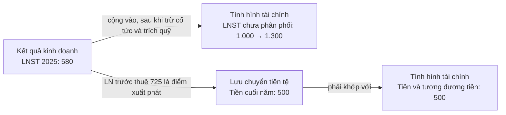

# Bài 2: Đọc báo cáo tài chính

BCTC giống như **phiếu khám sức khỏe** của doanh nghiệp. Bạn không cần là kế toán để đọc nó. Bạn chỉ cần biết **mỗi báo cáo trả lời câu hỏi gì** và **nên nhìn vào những dòng nào**.

## 1. Một bộ BCTC gồm những gì?

| Báo cáo | Câu hỏi nó trả lời | Hình dung |
|---|---|---|
| **Báo cáo tình hình tài chính** (trước năm 2026 gọi là **Bảng cân đối kế toán**), mẫu B01 | Tại một thời điểm, doanh nghiệp **có những gì**, và tiền để có chúng **đến từ đâu** (đi vay hay vốn của chủ)? | Ảnh chụp tài sản và các khoản nợ của một gia đình vào ngày 31/12 |
| **Báo cáo kết quả hoạt động kinh doanh**, mẫu B02 | Trong kỳ, doanh nghiệp **bán được bao nhiêu, lãi hay lỗ**? | Bảng thu nhập và chi tiêu của gia đình trong cả năm |
| **Báo cáo lưu chuyển tiền tệ**, mẫu B03 | Trong kỳ, **tiền mặt thực sự** vào ra bao nhiêu, vì những hoạt động nào? | Sổ ghi tiền thực tế vào ra ví |
| **Thuyết minh BCTC**, mẫu B09 | Chi tiết và giải thích cho từng con số | Phần ghi chú phía sau phiếu khám |

> [!NOTE]
> Từ năm tài chính 2026, chế độ kế toán doanh nghiệp mới (Thông tư 99/2025/TT-BTC, thay thế Thông tư 200/2014/TT-BTC) đổi tên "Bảng cân đối kế toán" thành **"Báo cáo tình hình tài chính"**. Bản chất không đổi: **Tài sản = Nợ phải trả + Vốn chủ sở hữu**. BCTC các năm trước vẫn dùng tên cũ, nên bạn sẽ gặp cả hai tên.

### Các loại BCTC theo kỳ

| Loại | Ai kiểm tra | Thời hạn công bố (công ty niêm yết, tham khảo) | Độ tin cậy |
|---|---|---|---|
| BCTC quý | Doanh nghiệp tự lập | Khoảng 20–30 ngày sau khi hết quý | Thấp nhất; dùng để theo dõi xu hướng |
| BCTC bán niên | Kiểm toán viên **soát xét** | Không quá 45 ngày sau khi hết 6 tháng đầu năm | Trung bình |
| BCTC năm | Kiểm toán viên **kiểm toán** | Không quá 90 ngày sau khi hết năm tài chính | Cao nhất; dùng để phân tích chính |

- **BCTC hợp nhất và BCTC riêng:** nếu doanh nghiệp có công ty con, **hãy đọc BCTC hợp nhất** vì nó phản ánh cả tập đoàn. BCTC riêng chỉ thể hiện công ty mẹ, và có thể đẹp hoặc xấu một cách giả tạo do cổ tức nhận từ công ty con.
- **Văn bản giải trình:** khi lợi nhuận sau thuế thay đổi từ 10% trở lên so với cùng kỳ, doanh nghiệp niêm yết phải công bố giải trình nguyên nhân. Tài liệu này ngắn nhưng rất đáng đọc.
- **Báo cáo thường niên** và **tài liệu Đại hội đồng cổ đông** (kế hoạch kinh doanh, cổ tức) giúp bạn hiểu chiến lược, đồng thời so sánh được "lời hứa" của ban lãnh đạo với kết quả thực tế.

### Ý kiến kiểm toán: trang đầu tiên phải đọc

Trong BCTC năm, ngay sau báo cáo của Ban Giám đốc là **Báo cáo kiểm toán độc lập**. Hãy tìm đoạn "Ý kiến của kiểm toán viên".

| Ý kiến | Ý nghĩa | Bạn nên làm gì |
|---|---|---|
| **Chấp nhận toàn phần** | BCTC trung thực và hợp lý trên các khía cạnh trọng yếu | Bình thường, tiếp tục phân tích |
| **Ngoại trừ** | BCTC đúng, **trừ** một số khoản kiểm toán viên không đồng ý hoặc không đủ bằng chứng | Đọc kỹ khoản bị ngoại trừ. Nó lớn hay nhỏ so với lợi nhuận và vốn chủ? |
| **Trái ngược** | BCTC sai lệch trọng yếu | Tránh xa |
| **Từ chối đưa ra ý kiến** | Kiểm toán viên không thu thập đủ bằng chứng để kết luận | Tránh xa |

Hãy đọc cả đoạn **"Vấn đề cần nhấn mạnh"** nếu có. Đoạn này không làm thay đổi ý kiến kiểm toán, nhưng đôi khi nêu nghi ngờ về **khả năng hoạt động liên tục** của doanh nghiệp, một tín hiệu rất xấu.

## 2. Thứ tự đọc cho người mới (30–60 phút cho mỗi doanh nghiệp)

1. **Ý kiến kiểm toán** (2 phút). Có vấn đề nghiêm trọng thì dừng lại.
2. **Kết quả kinh doanh** 3–5 năm. Doanh nghiệp có tăng trưởng không, có lãi bền vững không?
3. **Tình hình tài chính.** Tài sản gồm những gì, nợ vay có nhiều không?
4. **Lưu chuyển tiền tệ.** Lợi nhuận có biến thành tiền không?
5. **Thuyết minh.** Tra cứu những khoản lớn hoặc biến động bất thường bạn thấy ở bước 2–4.

> [!TIP]
> Đừng đọc BCTC của một năm đơn lẻ. Hãy đặt **3–5 năm cạnh nhau** (các trang dữ liệu như CafeF, Vietstock có sẵn dạng bảng). Xu hướng cho bạn biết nhiều hơn một con số riêng lẻ.

## 3. Ví dụ xuyên suốt: Công ty Cổ phần ABC (giả định)

ABC sản xuất và phân phối đồ uống đóng chai. Công ty có **100 triệu cổ phiếu** đang lưu hành, giá thị trường **50.000đ/cổ phiếu**, năm 2025 trả cổ tức tiền mặt **2.500đ/cổ phiếu**. ABC không có công ty con, nên toàn bộ lợi nhuận và vốn chủ thuộc về cổ đông của ABC.

Đơn vị trong mọi bảng dưới đây: **tỷ đồng**.

## 4. Báo cáo kết quả kinh doanh: "Có lãi không?"

| Chỉ tiêu | 2024 | 2025 |
|---|---:|---:|
| Doanh thu bán hàng và cung cấp dịch vụ | 4.590 | 5.100 |
| Các khoản giảm trừ doanh thu | (90) | (100) |
| **Doanh thu thuần** | **4.500** | **5.000** |
| Giá vốn hàng bán | (3.195) | (3.500) |
| **Lợi nhuận gộp** | **1.305** | **1.500** |
| Doanh thu hoạt động tài chính | 40 | 50 |
| Chi phí tài chính | (75) | (80) |
| *Trong đó: chi phí lãi vay* | *(55)* | *(60)* |
| Chi phí bán hàng | (450) | (500) |
| Chi phí quản lý doanh nghiệp | (195) | (250) |
| **Lợi nhuận thuần từ hoạt động kinh doanh** | **625** | **720** |
| Lợi nhuận khác | 0 | 5 |
| **Tổng lợi nhuận kế toán trước thuế** | **625** | **725** |
| Chi phí thuế thu nhập doanh nghiệp | (125) | (145) |
| **Lợi nhuận sau thuế (LNST)** | **500** | **580** |

Số trong ngoặc ( ) là số âm, tức là khoản bị trừ đi. BCTC ở Việt Nam trình bày theo cách này.

### Đọc từng phần

- **Doanh thu thuần** = Doanh thu bán hàng − Các khoản giảm trừ (chiết khấu, hàng bán bị trả lại). Đây là điểm xuất phát của mọi phân tích. Doanh thu của ABC tăng **11,1%**.
- **Giá vốn hàng bán:** chi phí trực tiếp để làm ra sản phẩm, gồm nguyên vật liệu, nhân công sản xuất, khấu hao nhà máy.
- **Lợi nhuận gộp** = Doanh thu thuần − Giá vốn. **Biên lợi nhuận gộp** (LN gộp / Doanh thu thuần) cho thấy sức mạnh định giá. Biên gộp cao và ổn định thường nghĩa là sản phẩm khác biệt, thương hiệu mạnh hoặc chi phí sản xuất thấp. ABC: từ 29,0% lên 30,0%, cải thiện nhẹ.
- **Chi phí bán hàng, chi phí quản lý doanh nghiệp (QLDN):** quảng cáo, vận chuyển, lương bộ phận văn phòng... Chi phí bán hàng của ABC ổn định ở mức 10% doanh thu. Nhưng chi phí QLDN tăng **28%** (từ 195 lên 250 tỷ), nhanh hơn nhiều so với doanh thu. **Hãy ghi chú lại để tìm hiểu.**
- **Doanh thu và chi phí tài chính:** lãi tiền gửi, lãi vay, chênh lệch tỷ giá. Dòng "trong đó: chi phí lãi vay" cho biết gánh nặng nợ vay.
- **Lợi nhuận khác:** thanh lý tài sản, tiền phạt, bồi thường... Đây là những khoản **một lần**, không nên dựa vào.
- **LNST.** Với tập đoàn có công ty con, hãy dùng dòng **LNST của cổ đông công ty mẹ**, vì đó mới là phần thuộc về cổ đông như bạn.
- **Lãi cơ bản trên cổ phiếu (EPS):** LNST của cổ đông công ty mẹ chia cho số cổ phiếu lưu hành bình quân.

### Tự tính "lợi nhuận cốt lõi"

**Lợi nhuận cốt lõi = LN gộp − Chi phí bán hàng − Chi phí QLDN.**

ABC năm 2025: 1.500 − 500 − 250 = **750 tỷ**. Con số này lớn hơn lợi nhuận trước thuế (725 tỷ), nghĩa là lợi nhuận của ABC đến từ **hoạt động kinh doanh chính**, không phải từ tiền gửi hay thu nhập bất thường. Đây là điểm tốt.

Ngược lại, nếu một doanh nghiệp có lợi nhuận cốt lõi âm nhưng vẫn báo lãi lớn nhờ "doanh thu tài chính" hay "lợi nhuận khác", thì khoản lãi đó khó lặp lại.

### Câu hỏi nên đặt ra

- Doanh thu tăng đều hay thất thường? Tăng vì bán được nhiều hơn hay vì tăng giá bán? (Xem báo cáo thường niên.)
- Biên gộp có ổn định qua các năm không? Biên gộp giảm mạnh thường do chi phí nguyên liệu tăng, hoặc doanh nghiệp phải giảm giá vì cạnh tranh.
- Lợi nhuận tăng nhanh hơn doanh thu (biên lợi nhuận mở rộng) hay chậm hơn (biên lợi nhuận co lại)?
- Có khoản lợi nhuận đột biến một lần nào không?
- Với kết quả quý, hãy so với **cùng kỳ năm trước** (ví dụ quý 3/2025 so với quý 3/2024), không so với quý liền trước, vì nhiều ngành có tính mùa vụ.

## 5. Báo cáo tình hình tài chính: "Có gì, nợ ai?"

Phương trình cốt lõi: **Tổng tài sản = Nợ phải trả + Vốn chủ sở hữu.** Phía tài sản cho biết tiền đang được dùng vào đâu. Phía nguồn vốn cho biết tiền đó đến từ đâu.

**Tài sản** (số dư ngày 31/12)

| Chỉ tiêu | 2024 | 2025 |
|---|---:|---:|
| **A. Tài sản ngắn hạn** | **2.100** | **2.400** |
| Tiền và các khoản tương đương tiền | 450 | 500 |
| Đầu tư tài chính ngắn hạn (tiền gửi có kỳ hạn) | 200 | 300 |
| Các khoản phải thu ngắn hạn | 500 | 600 |
| Hàng tồn kho | 850 | 900 |
| Tài sản ngắn hạn khác | 100 | 100 |
| **B. Tài sản dài hạn** | **2.450** | **2.600** |
| Tài sản cố định | 2.100 | 2.200 |
| Tài sản dở dang dài hạn (công trình đang xây) | 150 | 200 |
| Đầu tư tài chính dài hạn | 100 | 100 |
| Tài sản dài hạn khác | 100 | 100 |
| **TỔNG TÀI SẢN** | **4.550** | **5.000** |

**Nguồn vốn** (số dư ngày 31/12)

| Chỉ tiêu | 2024 | 2025 |
|---|---:|---:|
| **C. Nợ phải trả** | **1.850** | **2.000** |
| *I. Nợ ngắn hạn* | *1.400* | *1.500* |
| Phải trả người bán | 560 | 600 |
| Người mua trả tiền trước | 90 | 100 |
| Vay và nợ thuê tài chính ngắn hạn | 450 | 500 |
| Phải trả khác (thuế, lương, quỹ khen thưởng phúc lợi...) | 300 | 300 |
| *II. Nợ dài hạn* | *450* | *500* |
| Vay và nợ thuê tài chính dài hạn | 350 | 400 |
| Nợ dài hạn khác | 100 | 100 |
| **D. Vốn chủ sở hữu** | **2.700** | **3.000** |
| Vốn góp của chủ sở hữu (100 triệu cổ phiếu × 10.000đ) | 1.000 | 1.000 |
| Thặng dư vốn cổ phần | 300 | 300 |
| Quỹ đầu tư phát triển | 400 | 400 |
| Lợi nhuận sau thuế chưa phân phối | 1.000 | 1.300 |
| **TỔNG NGUỒN VỐN** | **4.550** | **5.000** |

### Đọc phía tài sản

- **Tiền và đầu tư tài chính ngắn hạn** (chủ yếu là tiền gửi có kỳ hạn) là "tấm đệm" an toàn. ABC có 800 tỷ.
- **Phải thu ngắn hạn** là tiền khách hàng còn nợ do mua chịu. Hãy xem nó có tăng nhanh hơn doanh thu không. Phải thu của ABC tăng **20%**, trong khi doanh thu tăng 11%. Đây là một điểm cần theo dõi.
- **Hàng tồn kho** gồm nguyên liệu, thành phẩm chưa bán được. Tồn kho tăng nhanh hơn doanh thu có thể là hàng khó bán (rủi ro phải giảm giá), hoặc doanh nghiệp đang tích trữ cho mùa cao điểm.
- **Tài sản cố định** (nhà máy, máy móc) và **tài sản dở dang dài hạn** (công trình đang xây) cho biết doanh nghiệp "nặng tài sản" hay "nhẹ tài sản". Công trình dở dang kéo dài nhiều năm không hoàn thành là dấu hiệu xấu.

### Đọc phía nguồn vốn

- **Nợ phải trả** gồm 2 loại rất khác nhau:
  - **Nợ vay** (vay ngân hàng, trái phiếu; trên BCTC thường ghi là "Vay và nợ thuê tài chính"). Loại nợ này **phải trả lãi**, đến hạn phải trả gốc, nên cần soi kỹ. Nợ vay của ABC là 500 + 400 = 900 tỷ.
  - **Nợ chiếm dụng** (phải trả người bán, người mua trả tiền trước, phải trả người lao động...). Loại này thường **không mất lãi**. Doanh nghiệp có vị thế mạnh thường chiếm dụng được nhiều vốn của nhà cung cấp và khách hàng, đó là điểm tốt.
- **Vốn chủ sở hữu (VCSH)** là phần thuộc về cổ đông:
  - **Vốn góp của chủ sở hữu** = Số cổ phiếu × Mệnh giá 10.000đ. ABC: 100 triệu × 10.000đ = 1.000 tỷ.
  - **Thặng dư vốn cổ phần:** phần tiền thu được cao hơn mệnh giá khi phát hành cổ phiếu.
  - **Lợi nhuận sau thuế chưa phân phối:** phần lãi tích lũy qua các năm chưa chia, tức là phần doanh nghiệp "tự làm ra".
- **Lợi ích cổ đông không kiểm soát** (nếu có): phần vốn của các cổ đông khác tại công ty con. Phần này không thuộc về bạn.

### Câu hỏi nên đặt ra

- Nợ vay bằng bao nhiêu lần VCSH? Tiền mặt có đủ trả các khoản vay ngắn hạn không? (ABC: tiền và tiền gửi 800 tỷ, lớn hơn vay ngắn hạn 500 tỷ, nên an toàn.)
- Doanh nghiệp có dùng **nợ ngắn hạn để tài trợ tài sản dài hạn** không, chẳng hạn vay 6 tháng để xây nhà máy dùng 20 năm? Nếu có, rủi ro thanh khoản sẽ cao.
- VCSH tăng nhờ **lợi nhuận giữ lại** (tốt) hay nhờ **liên tục phát hành thêm cổ phiếu** (pha loãng)?
- Tài sản chủ yếu là tài sản "thật" (tiền, hàng hóa, máy móc), hay có nhiều khoản khó kiểm chứng (phải thu khác, lợi thế thương mại, chi phí trả trước)?

## 6. Báo cáo lưu chuyển tiền tệ: "Lãi có thành tiền không?"

Lợi nhuận được ghi nhận khi **bán hàng**, kể cả bán chịu. Còn tiền chỉ vào khi **khách hàng trả**. Vì vậy, doanh nghiệp có thể báo lãi mà vẫn cạn tiền. Báo cáo lưu chuyển tiền tệ chia dòng tiền thành 3 nhóm:

| Nhóm | Gồm những gì | Ở doanh nghiệp khỏe mạnh, thường là |
|---|---|---|
| **Hoạt động kinh doanh (CFO)** | Tiền thu từ khách hàng; tiền chi cho nhà cung cấp, lương, lãi vay, thuế | **Dương**, xấp xỉ hoặc lớn hơn LNST |
| **Hoạt động đầu tư (CFI)** | Mua sắm, xây dựng tài sản cố định; góp vốn; gửi tiền có kỳ hạn; thu từ thanh lý tài sản | Âm (đang đầu tư cho tương lai) |
| **Hoạt động tài chính (CFF)** | Vay mới, trả nợ gốc, phát hành cổ phiếu, trả cổ tức | Âm (trả nợ, trả cổ tức), hoặc dương khi cần vốn để mở rộng |

**ABC năm 2025** (phương pháp gián tiếp)

| Chỉ tiêu | 2025 |
|---|---:|
| **I. Hoạt động kinh doanh** | |
| Lợi nhuận trước thuế | 725 |
| Cộng: Khấu hao tài sản cố định | 250 |
| Cộng: Chi phí lãi vay | 60 |
| Trừ: Lãi từ hoạt động đầu tư (lãi tiền gửi) | (40) |
| *Lợi nhuận kinh doanh trước thay đổi vốn lưu động* | *995* |
| Tăng các khoản phải thu | (100) |
| Tăng hàng tồn kho | (50) |
| Tăng các khoản phải trả | 50 |
| Tiền lãi vay đã trả | (60) |
| Thuế thu nhập doanh nghiệp đã nộp | (140) |
| Tiền chi khác (chi quỹ khen thưởng, phúc lợi) | (35) |
| **Lưu chuyển tiền thuần từ hoạt động kinh doanh** | **660** |
| **II. Hoạt động đầu tư** | |
| Tiền chi mua sắm, xây dựng tài sản cố định | (400) |
| Tiền gửi có kỳ hạn tăng thêm | (100) |
| Tiền lãi tiền gửi nhận được | 40 |
| **Lưu chuyển tiền thuần từ hoạt động đầu tư** | **(460)** |
| **III. Hoạt động tài chính** | |
| Tiền thu từ đi vay | 1.200 |
| Tiền trả nợ gốc vay | (1.100) |
| Cổ tức đã trả cho cổ đông | (250) |
| **Lưu chuyển tiền thuần từ hoạt động tài chính** | **(150)** |
| **Lưu chuyển tiền thuần trong năm** | **50** |
| Tiền đầu năm | 450 |
| **Tiền cuối năm** | **500** |

Phần lớn doanh nghiệp lập báo cáo này theo **phương pháp gián tiếp** như trên: bắt đầu từ lợi nhuận trước thuế, rồi cộng trừ các khoản không phải tiền (như khấu hao) và các thay đổi của vốn lưu động. Bạn không cần thuộc từng dòng. Quan trọng nhất là con số **Lưu chuyển tiền thuần từ hoạt động kinh doanh**. Hãy nhớ quy tắc: phải thu và tồn kho tăng thì **giảm** tiền (số âm), còn các khoản phải trả tăng thì **tăng** tiền (số dương).

Đọc báo cáo của ABC:

- CFO đạt 660 tỷ, **lớn hơn** LNST 580 tỷ, nên lợi nhuận có chất lượng. Phần chênh lệch chủ yếu đến từ khấu hao 250 tỷ, một chi phí kế toán không tốn tiền mặt trong năm.
- Tiền chi mua sắm tài sản cố định (400 tỷ) lớn hơn khấu hao (250 tỷ), cho thấy ABC đang **mở rộng** sản xuất.
- **Dòng tiền tự do (FCF)** = CFO − Tiền chi mua sắm tài sản cố định = 660 − 400 = **260 tỷ**. Số này đủ trả 250 tỷ cổ tức mà không cần vay thêm.

### Sáu "chân dung" dòng tiền

| CFO | CFI | CFF | Chân dung | Ý nghĩa |
|:---:|:---:|:---:|---|---|
| + | − | − | Trưởng thành, khỏe mạnh | Tự làm ra tiền, vừa đầu tư vừa trả nợ, trả cổ tức. Lý tưởng |
| + | − | + | Đang mở rộng mạnh | Tiền tự làm ra chưa đủ, phải vay hoặc phát hành thêm. Xem dự án có hiệu quả không |
| + | + | − | Đang thu hẹp, tái cơ cấu | Bán tài sản để trả nợ. Cần tìm hiểu lý do |
| − | − | + | "Đốt tiền" | Kinh doanh chưa ra tiền, sống nhờ đi vay hoặc huy động vốn. Chấp nhận được với doanh nghiệp mới, **nguy hiểm** nếu kéo dài ở doanh nghiệp đã trưởng thành |
| − | + | − | Gặp khó khăn | Bán tài sản để trả nợ và bù cho dòng tiền kinh doanh âm. Rất rủi ro |
| − | + | + | Báo động | Vừa bán tài sản vừa đi vay chỉ để duy trì hoạt động |

## 7. Ba báo cáo liên kết với nhau thế nào?

- LNST năm 2025 (580) − Cổ tức (250) − Trích quỹ khen thưởng phúc lợi (30) = 300 tỷ. Đây đúng là phần tăng thêm của LNST chưa phân phối (từ 1.000 lên 1.300).
- Tiền cuối năm trên báo cáo lưu chuyển tiền tệ (500) bằng dòng "Tiền và các khoản tương đương tiền" trên báo cáo tình hình tài chính.
- Thay đổi của phải thu, tồn kho, phải trả giữa 2 năm trên báo cáo tình hình tài chính xuất hiện trong phần CFO (−100, −50, +50).
- Tiền chi mua sắm tài sản cố định (400) − Khấu hao (250) = 150 tỷ. Đây là phần tăng thêm của tài sản cố định và tài sản dở dang (từ 2.250 lên 2.400).
- Tiền vay mới (1.200) − Tiền trả nợ (1.100) = 100 tỷ. Đây là phần tăng thêm của nợ vay (từ 800 lên 900).

Hiểu những mối liên kết này giúp bạn phát hiện khi có điều gì đó "không khớp".

## 8. Thuyết minh BCTC: dùng để tra cứu, không cần đọc hết

Khi thấy một khoản lớn hoặc biến động mạnh, hãy mở phần thuyết minh tương ứng:

| Khoản mục | Tìm gì trong thuyết minh |
|---|---|
| Phải thu | Là phải thu khách hàng, hay "phải thu khác", tạm ứng, cho vay? Có phải thu từ **bên liên quan** không? Đã trích dự phòng nợ khó đòi chưa? |
| Hàng tồn kho | Là nguyên liệu, thành phẩm hay bất động sản dở dang? Đã trích **dự phòng giảm giá** chưa? |
| Vay nợ | Vay của ai, lãi suất bao nhiêu, kỳ hạn bao lâu, tài sản đảm bảo là gì? Trái phiếu đáo hạn khi nào? |
| Doanh thu theo bộ phận | Mảng nào đóng góp chính? Mảng nào đang tăng, mảng nào đang giảm? |
| Giao dịch với bên liên quan | Mua bán, cho vay với công ty của lãnh đạo hoặc cổ đông lớn, quy mô bao nhiêu? |
| Nợ tiềm tàng, sự kiện sau ngày kết thúc kỳ | Kiện tụng, bảo lãnh, cam kết lớn |

## 9. Lưu ý theo ngành

- **Ngân hàng:** BCTC có cấu trúc hoàn toàn khác. Hãy xem thu nhập lãi thuần, biên lãi thuần (NIM), tỷ lệ nợ xấu, tỷ lệ bao phủ nợ xấu, tỷ lệ tiền gửi không kỳ hạn (CASA), hệ số an toàn vốn (CAR). Ngân hàng chủ yếu được định giá bằng P/B, so sánh cùng ROE.
- **Công ty chứng khoán, bảo hiểm:** lợi nhuận phụ thuộc nhiều vào thị trường (tự doanh, cho vay margin), nên biến động mạnh.
- **Bất động sản:** hàng tồn kho lớn là bình thường (đó là các dự án). Khoản "người mua trả tiền trước" là doanh thu trong tương lai. Đặc biệt chú ý **nợ vay, trái phiếu** và dòng tiền kinh doanh.
- **Bán lẻ:** vòng quay hàng tồn kho, doanh thu trên mỗi cửa hàng, tốc độ mở cửa hàng mới.
- **Sản xuất hàng hóa cơ bản (thép, phân bón, dầu khí...):** lợi nhuận đi theo **chu kỳ giá hàng hóa**. P/E thấp ở đỉnh chu kỳ có thể là cái bẫy (xem Bài 4).

Người mới nên bắt đầu với **doanh nghiệp sản xuất, tiêu dùng hoặc dịch vụ dễ hiểu**, mà bạn dùng sản phẩm hằng ngày, trước khi đọc BCTC của ngân hàng hay doanh nghiệp bất động sản.

## 10. Bài tập

1. Chọn một doanh nghiệp niêm yết mà bạn dùng sản phẩm. Tải BCTC hợp nhất đã kiểm toán của năm gần nhất.
2. Ghi lại ý kiến kiểm toán.
3. Lập bảng 5 năm gồm: doanh thu thuần, LN gộp, LNST của cổ đông công ty mẹ, tổng tài sản, nợ vay, VCSH, CFO, tiền chi mua sắm tài sản cố định.
4. Trả lời 4 câu hỏi: Doanh nghiệp có tăng trưởng không? Có lãi từ hoạt động chính không? Nợ vay có đáng lo không? Lợi nhuận có thành tiền không?
5. Nhập số liệu 2 năm gần nhất vào [công cụ phân tích](cong-cu/phan-tich-bctc.html) và đối chiếu với nhận xét của bạn.

---

[← Bài 1: Kiến thức nền tảng](01-kien-thuc-nen-tang.md) · [Mục lục](README.md) · [Bài 3: Chỉ số tài chính →](03-chi-so-tai-chinh.md)
